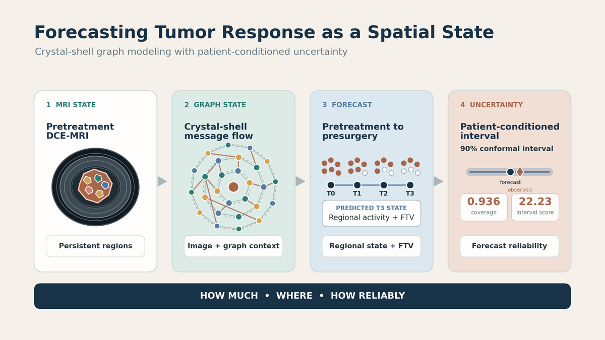

# Crystal-Shell Tumor Graph Forecasting with Patient-Conditioned Uncertainty

This repository is the dedicated code and artifact release for the Neural Computing and Applications manuscript, **“Tumor-Graph Deep Learning of Pretreatment DCE-MRI for Forecasting Regional Response, Functional Tumor Volume, and Patient-Conditioned Uncertainty in Breast Cancer.”** It contains the final selected model, the five trained fold checkpoints, the patient-level fold assignment, the uncertainty-selection records, aggregate manuscript results, and the source needed to rebuild the reported pipeline.

The public `v0.1.0` release preserves the implementation and checkpoints used for the submitted manuscript. The reviewer revision is being developed separately. Reviewer-requested inferential comparisons will enter a later version only after their patient-level inputs and numerical provenance are frozen. Exploratory model families, obsolete launchers, intermediate patient-level predictions, raw imaging, generated manuscript files, reviewer correspondence, and historical experiment archives are excluded.



> **Research-use boundary:** This is a retrospective modeling study. The implementation is not a medical device, clinical decision-support system, or treatment recommendation tool.

## Research objective

A scalar tumor-volume forecast can be numerically close while hiding the regional pattern that produced it. This study asks whether one pretreatment dynamic contrast-enhanced MRI examination can support three linked outputs:

1. a spatially resolved presurgery enhancing-tumor state.
2. a scalar presurgery functional tumor volume forecast.
3. a patient-specific 90% prediction interval selected without access to the held-out scoring cohort.

Persistent registered tumor regions form the graph nodes. Each node contains structured tumor descriptors and a frozen ImageNet-pretrained ResNet-18 embedding of local percent-enhancement and signal-enhancement-ratio patches. A crystal-shell relation defines typed within-shell, radial, feature-similarity, and temporal candidates. Learned edge gates control the contribution of each message. The predicted graph state supports regional evaluation, the FTV readout, and the uncertainty layer.

The pathologic complete response analysis is secondary to the pretreatment forecasting task. It combines baseline clinical covariates, observed graph-temporal summaries through the inter-regimen visit, and graph-derived model scores. It is not a pretreatment-only pCR classifier.

## Scientific contribution

The model connects three forms of evidence that are usually reported separately:

1. **Regional response:** The graph rollout predicts which tumor subregions remain enhancing at presurgery.
2. **Scalar response:** The same predicted graph state produces a presurgery functional tumor volume forecast.
3. **Patient-specific reliability:** A train-only-selected conformal procedure attaches a 90% prediction interval to the FTV forecast before held-out scoring.

The ablation study separates the roles of image content and graph structure. Frozen image embeddings provide most of the scalar FTV improvement. Crystal-shell message passing reduces active-subregion count error from 14.13 to 2.24 while preserving FTV accuracy. The uncertainty-selection protocol uses I-SPY2 out-of-fold results and does not use ACRIN-6698 to choose the reported method.

## Final NCA model

The released model tag is `resnet_crystal_edgegate_rd_k8`. Its final configuration is recorded in [`configs/paper_model.json`](configs/paper_model.json) and inside each checkpoint.

| Component | Final setting |
| --- | --- |
| Image representation | Frozen ResNet-18 ImageNet-1K embeddings |
| Structured channels | Six graph-state channels |
| Graph relation | `crystal_shell_union` |
| Edge attributes | `ssl_radial_bio` |
| Message passing | Two relational edge-gated layers, 64 hidden channels |
| Neighborhood parameter | Eight candidates per base relation |
| Training | Five patient-level folds, AdamW, scheduled sampling |
| Point forecast | Regional rollout with graph-derived FTV |
| Primary uncertainty | 256-sample residual Monte Carlo with leave-target-out conformal calibration |
| Frozen refinement | Locally scaled conformal intervals selected on I-SPY2 out-of-fold interval score |

The five final checkpoints are in [`models/checkpoints`](models/checkpoints), and their SHA-256 hashes are in [`models/checksums.sha256`](models/checksums.sha256). Each checkpoint is approximately 434 KB and contains the state dictionary, normalization statistics, training configuration, selected epoch, and validation metrics. All five hashes match the final Cradle run tree for `resnet_crystal_edgegate_rd_k8`.

## Study design and evidence boundary

The manuscript reports 556 I-SPY2 patients for model fitting, out-of-fold calibration, and method selection. It then scores 202 ACRIN-6698 patients that were withheld from those operations. ACRIN-6698 is nested within the I-SPY2 trial family. The held-out analysis measures generalization across acquisitions and sites within that trial family. It is not validation on a separate clinical trial.

The released [`splits/ispy2_folds.parquet`](splits/ispy2_folds.parquet) contains the public collection identifiers and patient-level fold assignment used by the pipeline. Raw DICOM, registered volumes, tumor masks, graph tensors, and patient-level predictions remain outside this repository.

## Reported aggregate results

The following values are the reference values reported in the submitted NCA manuscript. They describe the held-out ACRIN-6698 analysis and are not the result of a new run from this checkout.

| Endpoint | Held-out result |
| --- | ---: |
| Deterministic presurgery FTV MAE | 3.08 mL |
| Presurgery point-cloud Chamfer distance | 3.40 mm |
| Presurgery sliced Wasserstein distance | 1.17 mm |
| Active-subregion count MAE | 2.24 |
| No-message active-subregion count MAE | 14.13 |
| Primary Monte Carlo 90% coverage | 0.921, 186 of 202 |
| Primary interval mean width | 17.30 mL |
| Primary interval score | 28.24 |
| Frozen locally scaled conformal coverage | 0.936, 189 of 202 |
| Frozen interval mean width | 19.04 mL |
| Frozen interval score | 22.23 |
| Internally selected pCR model-stack AUC | 0.807 |
| Reduced clinical plus graph-temporal pCR AUC | 0.826 |

The locally scaled conformal method improved empirical coverage and interval score while increasing mean interval width. The pCR analysis includes observed early-treatment and inter-regimen features, so it is not a pretreatment-only classification result.

**Numerical provenance note:** The submitted manuscript reports locally scaled conformal coverage of 0.936, or 189 of 202 patients, with mean width 19.04 mL and interval score 22.23. The aggregate verification file included in public release `v0.1.0` records 0.931, or 188 of 202 patients, with mean width 19.01 mL and interval score 22.22. The selected method, held-out cohort, point forecast, and scientific interpretation are unchanged. The revision workflow is preserving both records until one canonical freeze is established and documented for `v0.2.0`.

The frozen tables, method ranking, topology controls, paired comparisons, deterministic summary, and pCR summaries are in [`reports/reproducibility/nca`](reports/reproducibility/nca).

## Relationship to the earlier public graph repository

This repository has an independent Git history and remote. It is separate from [`mirisr/breast-dce-mri-graph-rollouts`](https://github.com/mirisr/breast-dce-mri-graph-rollouts).

| Earlier graph-rollout repository | This NCA repository |
| --- | --- |
| Endpoint-calibrated Hybrid-Edge rollout model | Frozen image embeddings with crystal-shell edge-gated relations |
| Earlier graph-native FTV study | Joint regional state, FTV, patient-conditioned uncertainty, and secondary pCR analysis |
| Earlier model family and checkpoints | Final `resnet_crystal_edgegate_rd_k8` model and five NCA checkpoints |
| Separate public history | Independent NCA release history |

Weights or results from the earlier repository should not be substituted for the checkpoints released here.

## Repository layout

```text
configs/                         Final NCA model and uncertainty configuration
datasets/ispy2/scripts/          Data indexing, preprocessing, registration, and graph construction
docs/                            Data and reproducibility documentation
environment/                     Idempotent Cradle environment setup
experiments/image_to_graph/      Frozen ResNet-18 patch embedding stage
experiments/stage1_forecaster/   Final graph forecaster, evaluation, and pCR probe code
experiments/consistent_rollout/  Residual Monte Carlo and conformal uncertainty code
lsgc/                            Graph layers, final forecaster, metrics, and checkpoint inference
models/checkpoints/              Five trained NCA fold checkpoints
reports/reproducibility/nca/     Frozen aggregate results and selection artifacts
scripts/                         Final training, evaluation, UQ, audit, and smoke-test commands
splits/                          Released patient-level fold assignment
```

## Installation

The final Cradle environment used Python 3.11.15, PyTorch 2.5.1 with CUDA 12.1, torchvision 0.20.1, PyTorch Geometric 2.6.1, NumPy 1.26.4, pandas 2.2.3, SciPy 1.15.3, scikit-learn 1.8.0, and pyarrow 24.0.0.

For a CPU verification environment:

```bash
python3.11 -m venv .venv
source .venv/bin/activate
python -m pip install --upgrade pip
python -m pip install --index-url https://download.pytorch.org/whl/cpu \
  torch==2.5.1 torchvision==0.20.1
python -m pip install -r requirements.txt
python -m pip install -e . --no-deps
```

For Cradle or another compatible SLURM cluster:

```bash
bash environment/setup_cradle.sh
source environment/paths.sh
```

## Reproducibility levels

The repository supports two levels of verification:

| Level | What can be checked |
| --- | --- |
| Data-free artifact verification | Checkpoint hashes, configuration loading, architecture reconstruction, synthetic T0-to-T3 rollout, unit tests, and release-boundary audit |
| Full numerical reproduction | Data preparation, graph construction, five-fold training, deterministic held-out evaluation, Monte Carlo sampling, conformal selection, and pCR analysis using the source collections and private derived tensors |

The first level runs directly from this repository. The second requires the TCIA source collections and derived imaging artifacts that cannot be redistributed here.

## Verify the released artifacts

The smoke test verifies all five checkpoint hashes, loads each model, and performs a synthetic pretreatment-to-presurgery rollout through the final architecture:

```bash
python scripts/smoke_test.py
```

Run the curated data-free tests and release audit with:

```bash
python scripts/audit_public_release.py
python -m pytest -q \
  lsgc/tests/test_edge_modes.py \
  lsgc/tests/test_forecaster.py \
  lsgc/tests/test_image_to_graph.py \
  datasets/ispy2/scripts/tests \
  experiments/consistent_rollout/tests \
  experiments/consistent_rollout/test_paper_model_uq_ispy2_ranking.py
```

These checks verify implementation behavior and artifact integrity. They do not reproduce the manuscript metrics without the source imaging and derived graph tensors.

## Data access

The source collections are distributed through The Cancer Imaging Archive under their applicable terms:

- [I-SPY2 breast DCE-MRI, DOI 10.7937/TCIA.D8Z0-9T85](https://doi.org/10.7937/TCIA.D8Z0-9T85)
- [ACRIN-6698, DOI 10.7937/TCIA.KK02-6D95](https://doi.org/10.7937/TCIA.KK02-6D95)

See [`datasets/ispy2/README.md`](datasets/ispy2/README.md) and [`docs/DATA.md`](docs/DATA.md) for the expected local layout and exclusions.

## Reproduce the final NCA pipeline

After the imaging and clinical tables have been obtained under their source terms, the final workflow is:

1. Build the imaging index, select the longitudinal examinations, preprocess visits, register follow-up images to pretreatment, and construct persistent tumor supervoxels.
2. Attach frozen ResNet-18 patch embeddings with `experiments/image_to_graph/attach_torchvision_patch_embeddings.py`.
3. Train one final model per fold. For example, run `FOLD=0 scripts/train_nca_fold.sh`, then repeat for folds 1 through 4. A SLURM array can set `SLURM_ARRAY_TASK_ID` from 0 through 4.
4. Run `scripts/evaluate_nca_model.sh` for deterministic regional and FTV evaluation.
5. Run `SPLIT=ispy2_oof scripts/run_nca_monte_carlo.sh` and `SPLIT=acrin_holdout scripts/run_nca_monte_carlo.sh` to create the calibration and held-out Monte Carlo features.
6. Run `scripts/run_nca_uq_methods.sh` to fit, rank, freeze, and score the patient-conditioned uncertainty methods.
7. Run the pCR probe code only with the same frozen cohort assets and graph-derived prediction inputs used by the final analysis.

The detailed file contract, leakage controls, and acceptance checks are in [`docs/REPRODUCIBILITY.md`](docs/REPRODUCIBILITY.md).

## Release boundary

The repository includes the code, fold assignment, five final checkpoints, and aggregate result artifacts needed to inspect the NCA analysis. It excludes raw or derived images, graph tensors, patient-level predictions, Monte Carlo samples, manuscript submission packages, reviewer correspondence, experiment logs, and exploratory model families.

## Citation

Citation metadata are provided in [`CITATION.cff`](CITATION.cff). Until the manuscript receives a persistent publication identifier, cite this repository by title, author, version, and commit hash.

## License

Copyright © 2026 Iris Seaman. The code and released checkpoints are available for scholarly review and research reproducibility. Commercial or clinical use requires written permission. The source imaging remains governed by the custodial archives’ terms.
